# Especificación para OpenCode
## Diagrama: Marco contextual actual
### Condiciones económicas y políticas

---

# 1. Objetivo

Reproducir en una sola lámina horizontal 16:9 el diagrama **“Marco contextual actual”**, manteniendo la estética académica y visual utilizada en `ejemplo.pptx`.

La representación debe ser **esquemática**, con **ocho bloques numerados**, organizados en **dos filas de cuatro tarjetas**, sin saturación gráfica.

La lectura debe permitir identificar rápidamente:

```text
Contexto económico
→ desempeño del sector
→ empleo
→ siniestralidad
→ regulación
→ responsabilidad patronal
→ perspectiva técnica y sistémica
```

---

# 2. Formato general

```text
Relación: 16:9
Resolución recomendada: 1600 × 900 px
Fondo: blanco
```

Paleta:

```text
Verde principal: #087A59
Verde oscuro:    #005A40
Verde claro:     #EAF6F1

Rojo principal:  #C9252D
Rojo oscuro:     #9E1D23
Rojo claro:      #FCEDEE

Gris claro:      #F1F3F4
Gris medio:      #BFC5C9
Texto:           #22262A
```

---

# 3. Título

## Título principal

```text
Marco contextual actual
```

## Subtítulo

```text
Condiciones económicas y políticas
```

Estilo:

```text
Título: 38–44 px, negrita, color #22262A
Subtítulo: 22–26 px, regular, color #687078
Alineación: izquierda
```

---

# 4. Estructura del diagrama

Organizar ocho tarjetas en dos filas:

```text
FILA 1
[1] Contexto del sector
[2] Desempeño económico
[3] PIB construcción
[4] Empleo y concentración

FILA 2
[5] Siniestralidad laboral
[6] Marco regulatorio
[7] Responsabilidad patronal
[8] Perspectiva técnica y sistémica
```

Cada tarjeta debe tener:

- número dentro de un círculo;
- título en negrita;
- 2–4 líneas de palabras clave;
- borde redondeado;
- línea superior de color;
- fondo blanco o gris muy claro.

---

# 5. Contenido exacto de los bloques

## BLOQUE 1 — Contexto del sector

Color: verde.

```text
1
Contexto del sector

Pilar de la economía
Contribuye al PIB
Generador de empleo
```

---

## BLOQUE 2 — Desempeño económico

Color: verde.

```text
2
Desempeño económico

Economía 2023: 1,5 %
Construcción 2022: 1,1 %
Construcción 2024: 1,7 %
```

---

## BLOQUE 3 — PIB construcción

Color: verde.

```text
3
PIB construcción

USD 10.887 millones (2023)
USD 11.179 millones (2024)
Fuente: BCE / EKOS
```

---

## BLOQUE 4 — Empleo y concentración

Color: verde.

```text
4
Empleo y concentración

6,3 % del empleo nacional
521.599 contrataciones
Guayas 36,2 % · Pichincha 33,4 %
```

---

## BLOQUE 5 — Siniestralidad laboral

Color: verde.

```text
5
Siniestralidad laboral

PEA 2017: 8.084.382
22.405 accidentes
1.044 enfermedades profesionales
```

---

## BLOQUE 6 — Marco regulatorio

Color: rojo.

```text
6
Marco regulatorio

SGRT – IESS
Ministerio del Trabajo
Normativa obligatoria
```

---

## BLOQUE 7 — Responsabilidad patronal

Color: verde.

```text
7
Responsabilidad patronal

Auditoría técnico-administrativa
Indemnizaciones y sanciones
Prevención como obligación
```

---

## BLOQUE 8 — Perspectiva técnica y sistémica

Color: rojo.

```text
8
Perspectiva técnica y sistémica

Suárez Sánchez (2021)
Nørgaard (2018)
Prevención integrada a la dirección
de proyectos
```

---

# 6. Referencias inferiores

Ubicar una sola línea al pie:

```text
(Zabala & Guamán, 2024; Toro et al., 2021; Suárez Sánchez, 2021; Nørgaard, 2018)
```

Formato:

```text
font-size: 17–19 px
color: #777D82
font-style: normal
```

---

# 7. Mermaid base

Usar este Mermaid únicamente como guía estructural.  
Para reproducir fielmente el aspecto de la imagen se recomienda que OpenCode genere posteriormente la versión definitiva con **HTML + CSS**, ya que Mermaid tiene menor control sobre tamaño y posición.

```mermaid
flowchart TB

    %% =========================
    %% TÍTULO
    %% =========================
    T["MARCO CONTEXTUAL ACTUAL<br/><span style='font-size:18px;font-weight:400'>Condiciones económicas y políticas</span>"]

    %% =========================
    %% FILA SUPERIOR
    %% =========================
    subgraph F1[" "]
        direction LR

        A["<b>1 · Contexto del sector</b><br/><br/>Pilar de la economía<br/>Contribuye al PIB<br/>Generador de empleo"]

        B["<b>2 · Desempeño económico</b><br/><br/>Economía 2023: 1,5 %<br/>Construcción 2022: 1,1 %<br/>Construcción 2024: 1,7 %"]

        C["<b>3 · PIB construcción</b><br/><br/>USD 10.887 millones (2023)<br/>USD 11.179 millones (2024)<br/>Fuente: BCE / EKOS"]

        D["<b>4 · Empleo y concentración</b><br/><br/>6,3 % del empleo nacional<br/>521.599 contrataciones<br/>Guayas 36,2 % · Pichincha 33,4 %"]
    end

    %% =========================
    %% FILA INFERIOR
    %% =========================
    subgraph F2[" "]
        direction LR

        E["<b>5 · Siniestralidad laboral</b><br/><br/>PEA 2017: 8.084.382<br/>22.405 accidentes<br/>1.044 enfermedades profesionales"]

        F["<b>6 · Marco regulatorio</b><br/><br/>SGRT – IESS<br/>Ministerio del Trabajo<br/>Normativa obligatoria"]

        G["<b>7 · Responsabilidad patronal</b><br/><br/>Auditoría técnico-administrativa<br/>Indemnizaciones y sanciones<br/>Prevención como obligación"]

        H["<b>8 · Perspectiva técnica y sistémica</b><br/><br/>Suárez Sánchez (2021)<br/>Nørgaard (2018)<br/>Prevención integrada a la dirección de proyectos"]
    end

    %% =========================
    %% REFERENCIAS
    %% =========================
    R["(Zabala & Guamán, 2024; Toro et al., 2021; Suárez Sánchez, 2021; Nørgaard, 2018)"]

    T --> F1
    F1 --> F2
    F2 --> R

    %% =========================
    %% ESTILOS
    %% =========================
    classDef greenCard fill:#FFFFFF,stroke:#087A59,stroke-width:3px,color:#22262A;
    classDef redCard fill:#FFFFFF,stroke:#C9252D,stroke-width:3px,color:#22262A;
    classDef title fill:#FFFFFF,stroke:#FFFFFF,color:#22262A,font-size:32px,font-weight:bold;
    classDef ref fill:#FFFFFF,stroke:#FFFFFF,color:#777D82,font-size:15px;

    class A,B,C,D,E,G greenCard;
    class F,H redCard;
    class T title;
    class R ref;

    style F1 fill:#FFFFFF,stroke:#FFFFFF
    style F2 fill:#FFFFFF,stroke:#FFFFFF
```



---

# 8. Recomendación para implementación final en OpenCode

Para obtener un resultado prácticamente igual al diagrama de referencia, usar:

```text
HTML + CSS
```

y reservar Mermaid solo para la estructura conceptual.

La cuadrícula principal debe implementarse con:

```css
.context-grid{
  display:grid;
  grid-template-columns:repeat(4,1fr);
  grid-template-rows:repeat(2,1fr);
  gap:18px 14px;
}
```

---

# 9. Estructura HTML sugerida

```html
<section class="context-slide">

  <header class="slide-header">
    <h1>Marco contextual actual</h1>
    <h2>Condiciones económicas y políticas</h2>
  </header>

  <div class="context-grid">

    <article class="context-card green">
      <span class="number">1</span>
      <h3>Contexto del sector</h3>
      <p>Pilar de la economía</p>
      <p>Contribuye al PIB</p>
      <p>Generador de empleo</p>
    </article>

    <article class="context-card green">
      <span class="number">2</span>
      <h3>Desempeño económico</h3>
      <p>Economía 2023: 1,5 %</p>
      <p>Construcción 2022: 1,1 %</p>
      <p>Construcción 2024: 1,7 %</p>
    </article>

    <article class="context-card green">
      <span class="number">3</span>
      <h3>PIB construcción</h3>
      <p>USD 10.887 millones (2023)</p>
      <p>USD 11.179 millones (2024)</p>
      <p>Fuente: BCE / EKOS</p>
    </article>

    <article class="context-card green">
      <span class="number">4</span>
      <h3>Empleo y concentración</h3>
      <p>6,3 % del empleo nacional</p>
      <p>521.599 contrataciones</p>
      <p>Guayas 36,2 % · Pichincha 33,4 %</p>
    </article>

    <article class="context-card green">
      <span class="number">5</span>
      <h3>Siniestralidad laboral</h3>
      <p>PEA 2017: 8.084.382</p>
      <p>22.405 accidentes</p>
      <p>1.044 enfermedades profesionales</p>
    </article>

    <article class="context-card red">
      <span class="number">6</span>
      <h3>Marco regulatorio</h3>
      <p>SGRT – IESS</p>
      <p>Ministerio del Trabajo</p>
      <p>Normativa obligatoria</p>
    </article>

    <article class="context-card green">
      <span class="number">7</span>
      <h3>Responsabilidad patronal</h3>
      <p>Auditoría técnico-administrativa</p>
      <p>Indemnizaciones y sanciones</p>
      <p>Prevención como obligación</p>
    </article>

    <article class="context-card red">
      <span class="number">8</span>
      <h3>Perspectiva técnica y sistémica</h3>
      <p>Suárez Sánchez (2021)</p>
      <p>Nørgaard (2018)</p>
      <p>Prevención integrada a la dirección de proyectos</p>
    </article>

  </div>

  <footer>
    (Zabala & Guamán, 2024; Toro et al., 2021; Suárez Sánchez, 2021; Nørgaard, 2018)
  </footer>

</section>
```

---

# 10. CSS base recomendado

```css
*{
  box-sizing:border-box;
}

body{
  margin:0;
  background:#FFFFFF;
  font-family:Arial, Helvetica, sans-serif;
  color:#22262A;
}

.context-slide{
  width:1600px;
  height:900px;
  padding:38px 34px 28px;
  background:#FFFFFF;
}

.slide-header{
  margin-bottom:26px;
}

.slide-header h1{
  margin:0;
  font-size:44px;
  font-weight:800;
  color:#22262A;
}

.slide-header h2{
  margin:7px 0 0;
  font-size:25px;
  font-weight:400;
  color:#687078;
}

.context-grid{
  display:grid;
  grid-template-columns:repeat(4,1fr);
  gap:18px 14px;
}

.context-card{
  position:relative;
  min-height:220px;
  padding:28px 26px 22px 108px;
  background:#FFFFFF;
  border:1px solid #D7DCDD;
  border-radius:8px;
  box-shadow:0 2px 8px rgba(0,0,0,.04);
}

.context-card::before{
  content:"";
  position:absolute;
  left:0;
  right:0;
  top:0;
  height:8px;
  border-radius:8px 8px 0 0;
}

.context-card.green::before{
  background:#087A59;
}

.context-card.red::before{
  background:#C9252D;
}

.context-card .number{
  position:absolute;
  left:28px;
  top:27px;
  width:58px;
  height:58px;
  border-radius:50%;
  display:flex;
  align-items:center;
  justify-content:center;
  color:#FFFFFF;
  font-weight:800;
  font-size:28px;
}

.context-card.green .number{
  background:#087A59;
}

.context-card.red .number{
  background:#C9252D;
}

.context-card h3{
  margin:0 0 15px;
  font-size:24px;
  line-height:1.12;
  font-weight:800;
}

.context-card p{
  margin:6px 0;
  font-size:19px;
  line-height:1.2;
  color:#4D555C;
}

footer{
  margin-top:22px;
  font-size:19px;
  color:#777D82;
}
```

---

# 11. Reglas visuales obligatorias

OpenCode debe conservar:

- ocho tarjetas;
- dos filas de cuatro;
- línea superior verde o roja;
- círculo numerado;
- títulos en negrita;
- texto corto;
- referencias al pie;
- fondo blanco;
- ausencia de fotografías.

No convertir el contenido en un flujo con muchas flechas.  
La representación debe seguir siendo un **panel contextual estructurado**.

---

# 12. Prompt listo para OpenCode

```text
Crea una diapositiva HTML 16:9 de 1600 × 900 px titulada:

Marco contextual actual

Subtítulo:
Condiciones económicas y políticas

Mantén el estilo visual de ejemplo.pptx:
fondo blanco, bloques limpios, líneas verdes y rojas, tipografía académica y estructura muy esquemática.

Distribuye 8 tarjetas en una cuadrícula de 4 columnas × 2 filas.

Tarjeta 1, verde:
Contexto del sector
Pilar de la economía
Contribuye al PIB
Generador de empleo

Tarjeta 2, verde:
Desempeño económico
Economía 2023: 1,5 %
Construcción 2022: 1,1 %
Construcción 2024: 1,7 %

Tarjeta 3, verde:
PIB construcción
USD 10.887 millones (2023)
USD 11.179 millones (2024)
Fuente: BCE / EKOS

Tarjeta 4, verde:
Empleo y concentración
6,3 % del empleo nacional
521.599 contrataciones
Guayas 36,2 % · Pichincha 33,4 %

Tarjeta 5, verde:
Siniestralidad laboral
PEA 2017: 8.084.382
22.405 accidentes
1.044 enfermedades profesionales

Tarjeta 6, roja:
Marco regulatorio
SGRT – IESS
Ministerio del Trabajo
Normativa obligatoria

Tarjeta 7, verde:
Responsabilidad patronal
Auditoría técnico-administrativa
Indemnizaciones y sanciones
Prevención como obligación

Tarjeta 8, roja:
Perspectiva técnica y sistémica
Suárez Sánchez (2021)
Nørgaard (2018)
Prevención integrada a la dirección de proyectos

Cada tarjeta debe tener:
- número dentro de círculo,
- título en negrita,
- línea superior de color,
- borde gris claro,
- fondo blanco,
- esquinas redondeadas.

Añade al pie:
(Zabala & Guamán, 2024; Toro et al., 2021; Suárez Sánchez, 2021; Nørgaard, 2018)

Usa HTML + CSS.
Si se usa Mermaid, utilizarlo solamente como estructura conceptual; la versión visual final debe construirse con HTML/CSS para mantener el formato exacto.
```

---

# 13. Criterio de aceptación

El resultado será correcto si permite reconocer inmediatamente:

```text
importancia económica
+ evolución del sector
+ empleo
+ siniestralidad
+ presión regulatoria
+ responsabilidad patronal
+ necesidad de una gestión técnica y sistémica
```

sin necesidad de leer el texto completo del marco contextual.
